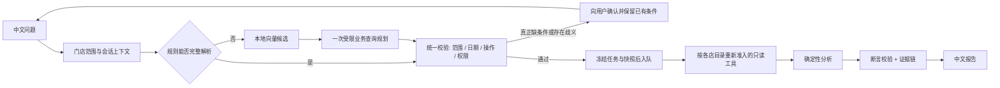

# 花迹 · 多门店经营调查 Agent

把「99红玫昨天为什么卖少了」这类口语问题，变成一份可追溯的经营调查：先冻结门店、商品与日期，再用只读工具查销售、流量、库存、活动和订单批次，由程序计算指标、检查缺口与冲突，模型只负责理解问题与组织表达。

- 核心运行时使用 Python 标准库，Python 3.11+；本地向量检索和外部评测有可选依赖
- 446 项离线回归测试通过（2026-10-31），不调用真实模型；后台线程未捕获异常为 0
- 数据是可重复生成的合成快照，**不是真实店铺记录**；评测是自建离线集，**不是官方榜单**

## 为什么不是「聊天框 + 查数」

普通问数产品只需要把 SQL 跑通；经营调查要回答的是「为什么」，而这里最容易出错的地方恰恰不在 SQL：

1. **模型可能用对格式、错对象**。计划看起来合法，却把 A 店的 SKU 查进了 B 店的时间窗。所以门店、商品、日期由宿主冻结，工具参数不允许模型覆盖。
2. **模型会用正确的数字写出错误的句子**。「完成订单包含迟到取消」这种关系错误，引用校验查不出来。所以关键数值要提交原始字段断言，由宿主逐条核对。
3. **缺失数据会被当成 0**。库存未监测、流量延迟、来源冲突，都必须显式保留为「不知道」，而不是「没发生」。

这三条决定了整个架构：**模型提出计划，程序保留执行权与验收权。**

## 快速开始

进入项目目录后，可先运行无模型演示和本地工作台。仓库只提供示例配置，不包含 API Key、访问口令或本地运行数据库。

```bash
python -m ecommerce_agent demo        # 5 个合成案例，确定性工作流，不联网
python -m ecommerce_agent web         # 网页工作台 http://127.0.0.1:8080
python -m ecommerce_agent ask "99红玫昨天销量下降原因" --today 2026-10-24 --preview
python -m ecommerce_agent evaluate-routing   # 离线路由回归，56 条，不调用模型
python -m ecommerce_agent briefing --store hx-sz-ns --date 2026-10-25   # 门店扫描，需年度数据
```

其他命令：`investigate`（指定 JSON 快照）、`agent`（真实模型自主调用工具）、`briefing`（门店每日简报）、`mcp`（只读 MCP Server）、`tunnel`（带口令的临时公网演示）、`tools`（打印工具 schema）。完整参数见 `python -m ecommerce_agent <command> --help`。

### 本地配置与验证

- DeepSeek 通过工作台左下角设置配置；密钥只保存在本机 `.env`，不放入源码或示例文件。
- `.env`、`config.local.json`、状态数据库、运行报告、模型缓存、年度数据与个人面试材料均不随仓库上传。
- 未配置模型时，固定演示和支持的规则查询仍可运行，复杂问题的模型规划不可用。
- 默认示例数据覆盖固定历史日期，演示时可问“南岸店99红玫10月25日销量怎么样”；当天、节日等范围需要对应历史数据。

```bash
# 仅外部评测适配层需要这两个依赖，与 CI 相同；核心演示不需要安装。
python -m pip install "pydantic>=2" "pyyaml>=6"
python -m unittest discover -s tests -q

# 可选本地向量检索；索引需显式构建，聊天请求不自动下载模型。
python -m pip install -e ".[semantic]"
python -m ecommerce_agent.semantic_router build
```

## 每日简报（Monitor）

`briefing` 先扫全店，再决定调查谁：以昨日基线触发绝对损失，用同星期中位数判断跌幅是否只是星期效应，并标注活动/日历背景；整日缺货与访客骤降作为独立信号。输出候选条目、同星期参考、证据来源，以及可直接提交的调查任务草稿。

```bash
python -m ecommerce_agent briefing --store hx-sz-ns --date 2026-10-25
python -m ecommerce_agent briefing --data data/sample.json --date 2026-10-23 --limit 5
```

`runs/briefing/<store>/<date>/` 下是 `briefing.md`、`briefing.json` 和 `tasks/*.json`；任务草稿字段与 `POST /api/tasks` 一致。命中不足 3 条时如实输出，不为了凑数下调阈值。

## 执行轨迹（Trace）

工作台任务详情里的“执行轨迹”入口（或直接打开 `/runs/<id>`）按发生顺序展示模型调用、工具调用、证据 ID、单步耗时、tokens、字段断言与拒绝原因。页面只读固定产物，不调用模型，也不执行源码：

- `run.json`：状态、停止原因、工具/模型次数与 token 账本；
- `events.jsonl`：模型/工具开始与结束、拒绝事件；
- `evidence.json`：本次引用的证据来源；
- `validation.json`：字段断言逐项结果。

拒绝步骤会显示宿主返回的错误和失败断言，能直接演示“这一条为什么被拒”；`finish` 通过时也能看到引用了哪些证据。运行 ID 走白名单正则，目录必须位于服务端运行根目录内，避免路径穿越。tokens 来自供应商上报，未上报时显示“未知”，不补零。

## MCP Server（只读）

把四个只读查询工具以 stdio MCP 暴露给 Claude Desktop / Cursor，协议用标准库实现，无第三方依赖：

```json
{"mcpServers": {"huaji": {"command": "python",
  "args": ["-m", "ecommerce_agent", "mcp"],
  "cwd": "C:/path/to/ecommerce-investigation-agent"}}}
```

工具面只有 `get_sales_metrics`、`get_traffic_metrics`、`get_inventory_status`、`get_promotion_history`，外加目录检索 `find_products`；没有分析器、`finish` 或任何写操作。参数是显式的 `sku_id` + `date`，服务端仍校验目录、日期上限和额外字段，未知对象返回可纠正的 `isError`，不会让客户端进程崩溃。

## 架构



三条链路的决策方不同，演示和面试时不要混为一谈：

| 模式 | 谁决定工具与参数 | 模型调用 | 用途 |
|---|---|---|---|
| 确定性工作流（`demo` / `investigate`） | 程序固定顺序 | 0 | 学习数据流、复现计算、回归 |
| 规则路由 | 词典与关键词 | 0 | 明确问题的最快路径 |
| 混合路由（网页默认） | 规则 → 本地向量候选 → 受限查询规划 | 业务查询规划至多 1 次 | 未完整理解的业务问题；必要信息缺失才追问 |

向量检索只提供意图候选，不直接授权执行；模型计划要经过宿主校验。复杂门店关系解析、业务查询规划和调查工具循环分别计数，不能把“规划至多一次”理解为整次任务只调用一次模型。服务故障、缺数据和真实歧义分别处理。

已确认的日期窗口、商品筛选、排名和基线通过 `QueryContext` 传递。跨店共享条件，各店重新绑定自己的目录成员，不继承其他门店的指标或证据。

## 核心设计

**1. 模型不拥有执行权。** 工具注册表在创建时冻结 SKU 与日期，模型只能请求已授权的只读工具；`finish` 之前必须完成四类查询，参数与调用顺序由宿主校验。

**2. 证据链与断言校验。** 每次工具调用落盘为带 `evidence_id` 的快照；模型完成时必须引用真实证据，并对关键数值提交不超过 12 条原始字段断言（字段白名单、等值匹配）。派生比例、因果结论不允许作为断言，只能由宿主计算或标注为候选线索。

**3. 有界预算。** 单次任务限制步数、时长与输出 token；业务查询规划至多一次，调查工具循环有独立预算；超限即停止并记录原因。

**4. 隔离与状态。** 每店独立的 SQLite 任务库与工作目录，会话只继承查询条件，不继承指标、证据或权限；写操作工具不存在。

**5. 从调查到可执行草稿。** 已完成的调查可以生成一张决策卡：把“建议先查什么”转成带判定规则和截止时间的工作单，人工批准后执行一次干跑，产出零副作用回执。决策卡、审批和回执都可追溯，但不会调用任何店铺写入接口。

## 评测结果

使用自建合成数据与评测集；自动化回归不调用真实模型，历史模型对照实验和录制回放另计。数字代表对应样本与版本的契约通过率，不代表线上准确率或业务收益；历史实验未随本次整理重新调用模型。

| 项目 | 结果 | 说明 |
|---|---|---|
| 自动化回归 | **446 / 446** | 2026-10-31 验证；约 2 分钟，后台线程未捕获异常为 0 |
| 路由回归 | **53 / 56** | 人工构造，非盲测；3 条为标签/行为口径差异，待对账 |
| 路由对照实验 | 规则 61/72、直接模型 70/72、混合 71/72 | 72 条配对样本；模型调用 0 / 59 / 18 次 |
| Golden 集 | 46 / 47（regression split） | holdout 33 条另计，已被观察过，不能称未见测试集 |
| 安全探针 | 越权 SKU、SQL 注入、重复步骤、未知操作全部拦截 | 对计划副本做攻击，不改业务数据 |
| Claw-Eval 适配 | 自建 8 条任务，3 次重复，Pass^3 8/8 | 固定 vendor commit；`--record/--replay` 可复现，**不是官方榜单成绩** |

### 外部评测快照

`vendor/claw-eval` 固定在上游 commit `5680b8b11ff2ee5dd2b07b89086a29a5c5c984d7`，逐文件 blob SHA 记录在 `SOURCE_SNAPSHOT.json`，MIT 许可。适配层支持：

```bash
python -m ecommerce_agent.claw_eval_adapter --report runs/.../quality-report.json --output runs/claw-record  # 录制
python -m ecommerce_agent.claw_eval_adapter --replay runs/claw-record                                      # 回放
```

回放只读录制目录，不读原始报告、不调用模型、不联网；CI 直接回放 `tests/fixtures/claw-replay`。仅评测层需要 `pydantic` 与 `pyyaml`，核心运行时仍保持 stdlib。

评测设计上做了三件容易被忽略的事：按 `regression` / `holdout` 分族且同族不跨 split；任务集与向量例句做逐字及字符 bigram 近似重复检测；数据、源码、fixture 各留 SHA256 指纹，避免把「底表改了」误判成「模型进步了」。

## 数据与口径

- 目录 28 款鲜花、6 家门店，日级数据覆盖 2026-10-11 至 2026-10-25；年度目录 320 款 × 365 天（`data/annual/`，体积大，不入库）。
- 四类数据域：销售（订单/买家/件数/金额）、流量（访客 UV）、库存（缺货分钟/监测分钟）、促销（活动与优惠券）。
- 口径要点：支付买家转化率用「买家数 ÷ 访客」，不是订单数或件数；缺失与延迟保留为 `unavailable`，不补零；来源冲突显式上报。

字段契约与接入方式见 [业务数据接入说明](docs/业务数据接入说明.md)。

## 目录结构

```text
ecommerce_agent/     业务与运行时（解析、路由、工具、分析、编排、Web、评测）
  runner.py          执行编排：固定流程与模型工具循环共用一套日志/预算
  tools.py           工具契约与参数校验
  mcp_server.py      只读 MCP stdio Server（四个查询工具 + 目录检索）
  briefing.py        门店每日简报：同星期参考 + 绝对损失 + 活动/日历
  query_plan.py      受限查询计划与授权
  analysis.py        确定性指标计算、缺口与冲突检查
  verification.py    断言校验
  conversations.py   多轮状态与门店工作记忆
  query_context.py   统一条件快照、追问合并与跨店重放
  web.py / web_service.py   网页工作台与后台任务
  trace_view.py      运行时间线：事件、证据、断言与拒绝原因
  web_assets/        原生 JS 工作台（无前端构建链）
data/                合成数据、商品目录、评测集
tests/               446 项离线回归
vendor/claw-eval/    固定 commit 的外部评测快照（MIT）
docs/                设计说明与学习文档
```

## 边界

- **没有生产上线**，没有真实门店数据、真实用户量或业务收益指标；不宣称任何营业额提升。
- **只读**：调查、决策卡和干跑都不改价、不调预算、不补货、不发送消息；真实写操作只由人工在商家后台完成。
- **未实现**：平台 API 连接器、文档 RAG、多 Agent 协作、多租户 RBAC、小时级因果调查、写操作执行。
- 模型叙述仍需人工语义核验；断言只校验收到的原始字段，不能证明整段文字正确。
- 轨迹页是单进程落盘事件的只读视图，不是 OpenTelemetry/分布式 tracing；没有跨服务链路与采样。
- `completed` 只表示本次工作流完成，不表示经营根因已查明。

## 文档

- [学习与架构说明](docs/学习与架构说明.md)：为什么要先做独立原型
- [第十八步：规则优先、模型分类与实时流程图](docs/第十八步-规则优先模型分类与实时流程图.md)：路由三层的取舍
- [第五步：会话式工作台设计](docs/第五步-会话式工作台设计.md)：多轮状态与隔离
- [第十一步：Mission 与门店独立记忆](docs/第十一步-Mission与门店独立记忆.md)
- [验证记录](docs/验证记录.md)：每轮实际执行了什么、没验证什么

## License

[MIT](LICENSE)
