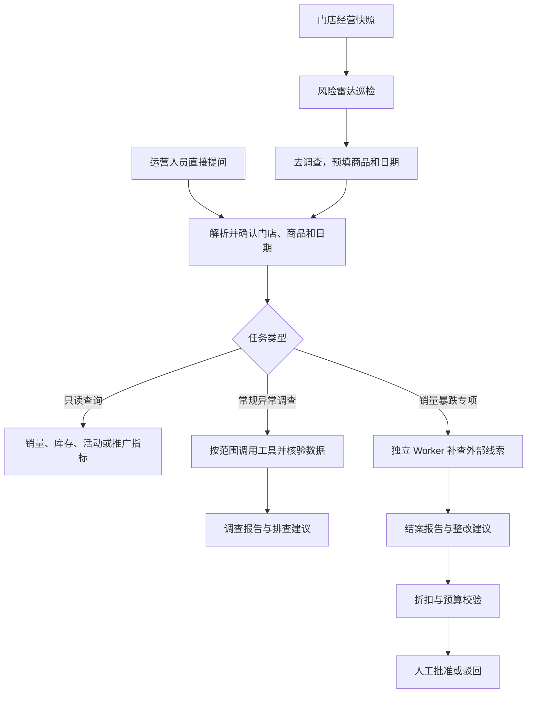

# 花迹｜多门店经营调查 Agent

花迹面向鲜花闪购门店的经营排查。输入「99 红玫 10 月 25 日为什么卖少了？」或从风险雷达选择一条预警，系统会锁定门店、商品和日期，查询经营记录，交付一份可复核的调查报告。涉及促销或投放的整改建议经过规则核验后，进入人工审批。

**技术栈**　Python 3.11+、SQLite、原生 JavaScript、Tool Calling、DeepSeek API（可选）、unittest。Web 工作台使用 Python 标准库，启动时无需前端构建或 Docker。

## 业务流程



| 输入 | 处理 | 输出 |
| --- | --- | --- |
| 门店、商品、日期及经营快照 | 按业务范围查询或比较 | 销量趋势、商品和门店排名、库存或活动状态、订单取消批次、门店推广费用 |
| 一条预警或自然语言调查请求 | 冻结查询范围，核对销量、流量、库存、活动和历史基线 | 事实、候选线索、数据缺口与排查顺序，附原始证据和运行轨迹 |
| 销量暴跌专项与可用的补充来源 | 独立 Worker 补查竞品价格、天气、节日和近七日门店广告记录 | 《调查结案报告》、整改建议、规则判定与人工审批记录 |
| 日期、计划类型、计划内容 | 保存备货或排班计划 | 运营日程中的按日计划列表 |

## 快速开始

```bash
git clone https://github.com/Dengzi555/huaji-flower-agent.git
cd huaji-flower-agent
python -X utf8 -m ecommerce_agent web --host 127.0.0.1 --port 8080
```

打开 [本地工作台](http://127.0.0.1:8080/)。同一个启动命令会打开 Web 服务、后台任务队列和定时风险巡检，任务状态保存在 SQLite。销量暴跌专项提交后按需启动独立 Python 子进程。

### 走一遍演示

1. 选择 **深圳南山店**，进入 **风险雷达**，找到 **2026-10-25 的 99 红玫销量预警**。
2. 点击 **去调查** 并提交。页面预填商品和日期，Worker 生成结案报告。也可直接输入「调查 99 红玫 2026 年 10 月 25 日销量暴跌的原因」。
3. 打开 **待办与审批草稿**。示例中的竞品降价会触发一条 **8 折促销草稿**，低于 **8.5 折**底线时会显示拦截原因。合规草稿可记录人工批准，实际执行由运营人员在商家后台完成。

仓库内置合成快照，可在未配置模型时演示规则查询和确定性调查。启用模型工具循环时，在 **系统设置与 API 配置** 中填写 DeepSeek API Key。演示问题请使用样例覆盖的固定日期。缺少当前日期数据时，系统会提示数据缺口。

```bash
# 离线演示
python -X utf8 -m ecommerce_agent demo

# 查看一句自然语言会生成怎样的任务卡
python -X utf8 -m ecommerce_agent ask "99红玫昨天销量下降原因" --today 2026-10-26 --preview

# 扫描一份样例，生成每日经营简报
python -X utf8 -m ecommerce_agent briefing --data data/sample.json --date 2026-10-25 --limit 5
```

## 工程设计

- **混合路由**。明确的规则查询走快捷路径。规则无法完整解析时，本地向量索引提供意图候选，启用模型后可发起一次有约束的业务规划。门店、SKU、日期和操作由宿主校验，调查工具循环单独记账。
- **任务执行与证据**。任务状态和数据快照保存在 SQLite。工具按冻结范围和角色白名单执行，输出 `run.json`、`events.jsonl`、`evidence.json` 和 `validation.json`。模型结案时校验引用和原始字段断言。业务页面默认展示结论，证据编号可在详情中复核。
- **雷达降噪**。每分钟扫描最近七个有记录的日期，覆盖活动断档、库存告急和销量暴跌。库存按累计缺货超过 120 分钟或库存低于安全线触发，每个 SKU 保留最新达标的库存告警。历史告警通过 SQLite UPSERT 原子更新，失效项在同一事务中清理。
- **整改审核**。结案建议使用结构化折扣或预算参数，在报告生成和人工批准时均校验。低于 8.5 折、单次预算超过 5,000 元或参数无效时拦截，并返回原因。

## 评测

| 检查 | 记录结果 | 样本和口径 |
| --- | --- | --- |
| 本地回归 | **538 项通过** | 含年度合成快照的工作区，使用下方 unittest 命令 |
| 路由对照 | 规则 **61/72**，直接模型 **70/72**，混合 **71/72** | 72 条自建配对样本，模型调用分别为 **0 / 59 / 18 次**，统计单位为调用次数 |
| 雷达降噪 | **762 → 2 条**库存预警 | 同一默认门店、同一份 7 日年度模拟快照重扫，统计告警量 |
| 规则拦截 | **8/8** 条非合规建议被拦截，**0/7** 条合规建议被误拦截 | 15 条标注样例，覆盖折扣、预算边界与非法参数 |
| 主快照端到端 | 红玫瑰 **12 → 5 件**触发跌幅预警 | 使用只读年度快照记录构造隔离用例，验证 SQLite、HTTP 返回和调查参数 |

评测使用合成快照与自建样本，指标按对应实验口径解读。历史路由对照使用模型，其余离线回归不请求外部模型。

```bash
python -m pip install "pydantic>=2" "pyyaml>=6"
python -X utf8 -m unittest discover -s tests -q

# 可选：构建本地向量索引
python -m pip install -e ".[semantic]"
python -m ecommerce_agent.semantic_router build

# 可选：生成年度合成快照，供主快照 E2E 和大样本演示使用
python -X utf8 -m ecommerce_agent.annual_data
```

主年度快照由本机生成，存放在 `data/annual/`。仓库内置的小样例足以启动工作台。主快照缺失时，依赖它的专项用例会跳过。外部评测适配及录制回放见 [Claw-Eval 快照说明](vendor/README.md)。

## 源码入口

| 模块 | 位置 |
| --- | --- |
| 任务准入与角色 | [`task_admission.py`](ecommerce_agent/task_admission.py)、[`roles.py`](ecommerce_agent/roles.py) |
| 模型工具循环和独立 Worker | [`runner.py`](ecommerce_agent/runner.py)、[`investigation_worker.py`](ecommerce_agent/investigation_worker.py) |
| 工具和原始字段核验 | [`tools.py`](ecommerce_agent/tools.py)、[`verification.py`](ecommerce_agent/verification.py) |
| 雷达、日程、审批与规则 | [`operations_board.py`](ecommerce_agent/operations_board.py)、[`approval_drafts.py`](ecommerce_agent/approval_drafts.py)、[`policy_checker.py`](ecommerce_agent/guardrails/policy_checker.py) |
| 网页和后台任务 | [`web.py`](ecommerce_agent/web.py)、[`task_execution.py`](ecommerce_agent/task_execution.py)、[`web_assets/`](ecommerce_agent/web_assets/) |

只读 MCP 入口可通过 `python -m ecommerce_agent mcp` 启动，提供商品目录检索与销量、流量、库存、活动查询。更多命令可运行 `python -m ecommerce_agent --help`。

## 数据与使用边界

- **合成数据**。内置门店、竞品价格和天气均为学习样例。调查会保留缺数、延迟和来源冲突，报告中的候选信号需要业务复核。
- **广告口径**。推广账本是门店级扣费和点击记录。SKU 级成交归因及 ROI/ROAS 需要另行接入对应数据。
- **人工执行**。审批保存人工决定。原有只读决策卡可生成干跑回执，改价、投放、补货等业务操作由运营人员处理。
- **本地配置**。API Key、状态数据库、年度数据和运行产物留在本机。当前按门店分开保存数据和任务，面向本地学习与演示。

延伸阅读：[业务数据接入](docs/业务数据接入说明.md) · [学习与架构](docs/学习与架构说明.md) · [验证记录](docs/验证记录.md)

## License

[MIT](LICENSE)
