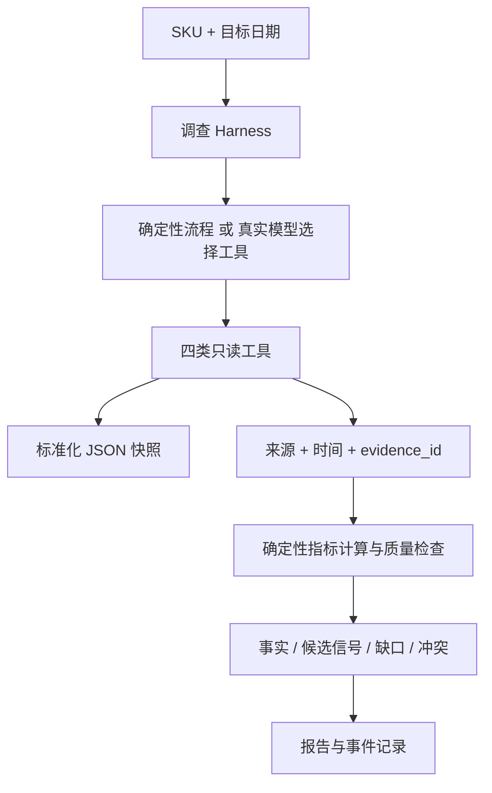

# 学习与架构说明

## 为什么先独立做原型

Craft Agents 已经提供会话、SDK 适配、工具接入、权限和桌面产品。我们当前需要先验证电商新增部分：数据口径、工具契约、计算、证据和调查流程。

如果第一天就修改大型 SessionManager，很容易把业务问题和框架问题混在一起。独立模块跑通后，再给工具加 MCP/API 外壳接入 Craft，学习边界更清楚。

当前没有完成 Craft 集成；工具定义 JSON 也不等于 MCP Server。

## 数据流



## 两种模式要分清

`demo / investigate`：程序固定查询四类来源并调用分析器，属于确定性工具工作流，不是自主推理。适合学习数据流、复现计算和验证异常边界。

`agent`：真实模型根据历史消息请求工具，Harness 执行并返回结果。模型不能改 SKU/日期、执行写操作或绕过分析器直接完成。数值事实来自程序；模型文字仍需语义核验。

本次开发只运行离线数据案例及协议 fixture，没有用真实外部模型测试调查效果。

## 读代码顺序

| 文件 | 先问什么 |
|---|---|
| `data.py` | 业务记录需要哪些字段？哪些输入应该拒绝？ |
| `tools.py` | 普通查询怎样变成模型能请求的工具？ |
| `analysis.py` | 哪些结果必须由程序算？哪些只能叫假设？ |
| `runner.py` | 谁驱动执行？什么时候算完成？失败在哪里落盘？ |
| `provider.py` | 模型服务和业务逻辑怎样隔离？ |
| `tests/test_investigation.py` | 这些承诺有哪些反例验证？ |

## 第一次练习

运行 FLR-ROSE-19-BOUQUET 案例：

```powershell
python -m ecommerce_agent demo --case FLR-ROSE-19-BOUQUET
```

观察报告：支付件数从 100 降到 50，访客从 1000 降到 500，支付买家转化率均为 10%。

你可以说“流量与销量同时下降，当前转化率没有下降”。不能说“已经证明广告投放导致销量下降”，因为没有广告数据，也没有控制其他变量。

接着运行 FLR-ROSE-33-BUCKET，比较报告为什么不再给出访客变化与支付转化率。

## 第二次练习

在输入副本中只提高支付订单数与件数，保持买家数和访客数不变，观察支付转化率是否变化。对应的系统回归测试会防止错误使用订单数/销量作为转化率分子。

不要修改唯一的合成样例来假装真实业务数据；用另一个文件保存自己的实验。

## 第三次练习

增加一种可验证的失败案例，例如同一 SKU 的两个重复日记录、买家与访客归因范围不一致、库存监测不足全天。先说明系统应该拒绝输入、标记缺口，还是输出冲突，再写代码。

## 与简历的关系

当前可展示产物：四个只读数据工具、日级 Schema、指标计算器、证据快照、五种模拟场景和系统回归测试。

尚不能宣称：接通淘宝/京东/抖店、生产经营根因诊断、自动改价、广告优化收益、真实模型成功率、MCP Hub、多 agent 协作、长期 Memory 或在线自进化。

后续建议按实际失败迭代：

1. 用真实模型跑已有案例，保存事实与模型叙述的差异。
2. 新增你有权限使用的数据导入 Adapter，核对指标映射。
3. 包装成只读 MCP 工具，接入 Craft 会话。
4. 增加小时级证据、同星期历史基线与独立评测案例。
5. 有明确需要后，再加独立 Reviewer 和人工审批动作。

你的个人经历应写实际学习、实现与验证的范围；基座功能、生成代码和你自己完成的改进要能区分。
